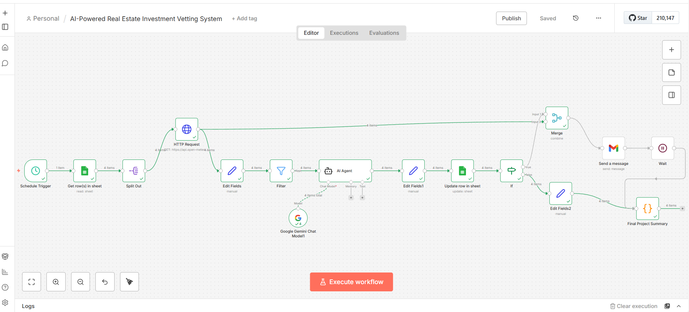
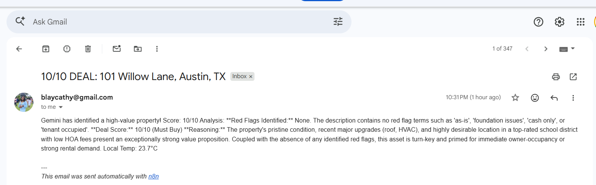

# AI-Powered-Real-Investment-Vetting-System

## 📝Project Overview
An **n8n** automation that screens property listings like an investment analyst. It reads listings from Google Sheets, add live weather data, has **Google Gemini** that score each deal from 1 to 10 and flag risks, saves the results to the sheet, and email the investor only when a property scores 9/10 or higher.

**Business Problem:** Investors reviewing hundreds of listings face information overload. Manually scanning descriptions for red flags (foundation issues, mold, cash-only terms) and calculating metrics like price per square foot is slow and inconsistent, and the best deals can be missed

## ⚙️How It Works
1. **Ingest:** A Schedule Trigger pulls properties from Google Sheets
2. **Enrich:** Each property gets a price per sq ft and current weather from the Open Meteo API
3. **Pre-screen:** A filter drops extreme outliers (over $1,000 per sq ft) before the AI step
4. **Analyze:** A Gemini AI Agent identifies red flags, assigns a Deal Score and writes two sentences of reasoning
5. **Record:** The score and analysis are saved back to the sheet
6. **Decide:** An If node sends 9/10 and 10/10 properties to a Gmail alert and tags the rest "Low Score- No Action Taken"

## 🧠 Skills Demonstration
- End-to-end automation design
- Prompt design
- Conditional logic and merging

## 🛠️ Tools Used
- n8n
- Google Sheets
- Google Gemini (AI agent)
- Open- Meteo API
- JavaScript

## 💡 What I Learned
- How to turn a business problem into an automation
- How to write a prompt that produces usable ouput
- How to handle messy AI output
- Where automation should stop

## 🔗 Preview

